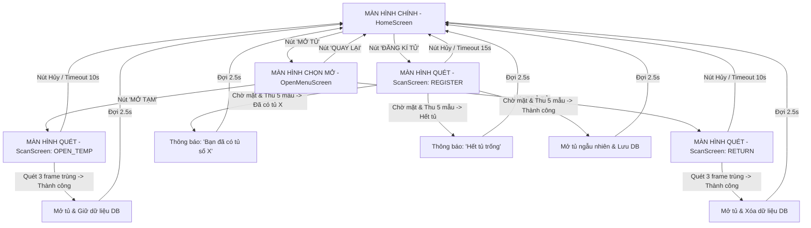
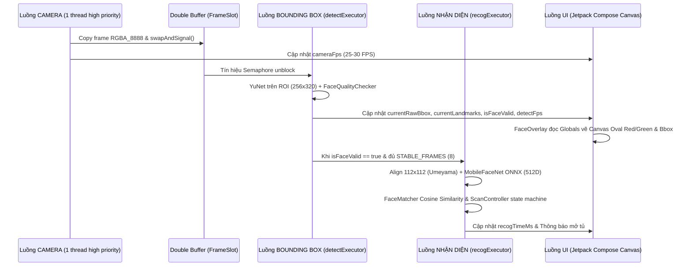

# TÀI LIỆU GIẢI THÍCH CHƯƠNG TRÌNH TỦ KHÓA LOCKER BẰNG KHUÔN MẶT

Tài liệu này mô tả chi tiết kiến trúc, luồng hoạt động, cấu trúc đa tiến trình, bảng tổng hợp toàn bộ biến Global & Local, cùng hướng dẫn hiệu chỉnh các ngưỡng cấu hình cho hệ thống Tủ Khóa Smart Face Locker.

---

## 1. SƠ ĐỒ LUỒNG MÀN HÌNH (SCREEN FLOW)

---

## 2. SƠ ĐỒ LUỒNG ĐA TIẾN TRÌNH (THREAD PIPELINE)

Hệ thống được thiết kế với pipeline 4 luồng chuyên biệt, không busy-wait, tự động bỏ frame nếu bận (drop frame) để đạt tốc độ realtime ≥ 25 FPS:

---

## 3. MÔ TẢ CÁC MODULE CHỨC NĂNG

| Thư mục | Module | Chức năng chính |
| :--- | :--- | :--- |
| `core/` | `AppConfig.kt` | Chứa toàn bộ hằng số cấu hình hệ thống (ngưỡng Cosine, timeout, kích thước ROI, FPS, ...). |
| `core/` | `Globals.kt` | Chứa toàn bộ biến Global thread-safe dùng chung trong ứng dụng có KDoc đầy đủ. |
| `core/` | `ThreadManager.kt` | Quản lý Thread Pool đặt tên riêng (`cameraExecutor`, `detectExecutor`, `recogExecutor`), phân bổ CPU core. |
| `camera/` | `FrameSlot.kt` | Double buffer lưu trữ frame RGBA 8888 nguyên dạng không cấp phát bộ nhớ dư thừa. |
| `camera/` | `CameraModule.kt` | Cấu hình CameraX `ImageAnalysis` (4:3 ratio, 640x480, `KEEP_ONLY_LATEST`) gắn PreviewView. |
| `detect/` | `YuNetDetector.kt` | Chạy model YuNet `FaceDetectorYN` OpenCV trên vùng ROI resize 256x320. |
| `detect/` | `RoiMapper.kt` | Tính toán tọa độ ROI pixel và xử lý lật gương (mirror) camera trước. |
| `detect/` | `FaceQualityChecker.kt` | Lọc mặt: hoàn toàn trong ROI, tỷ lệ kích thước `[0.40, 0.90]`, góc nhìn thẳng Yaw `< 0.25`, độ nét `>= 40.0`. |
| `recog/` | `FaceAligner.kt` | Thuật toán Umeyama Similarity Transform đưa 5 landmark về chuẩn ArcFace 112x112 không cấp phát RAM. |
| `recog/` | `MobileFaceNetEmbedder.kt` | Nạp `w600k_mbf.onnx` qua ONNX Runtime, trích xuất vector 512D & L2-normalize. |
| `recog/` | `FaceMatcher.kt` | So khớp Cosine Similarity (tích vô hướng 2 vector L2) kiểm tra ngưỡng `MATCH_THRESHOLD` và `MATCH_MARGIN`. |
| `data/` | `SecureCrypto.kt` | Mã hóa/Giải mã vector FloatArray 512D bằng AES-GCM-256 qua Android Keystore. |
| `data/` | `LockerDatabase.kt` / `LockerDao.kt` | Room Database lưu trữ danh sách tủ khóa an toàn offline. |
| `data/` | `LockerRepository.kt` | Đồng bộ lưu trữ giữa Room DB và bộ đệm RAM Cache (`Globals.embeddingsMemoryCache`). |
| `hardware/`| `LockerController.kt` / `FakeLockerController.kt` | Interface & Lop giả lập điều khiển rơ-le mở tủ (chừa TODO nối phần cứng thật). |
| `flow/` | `ScanController.kt` | State machine điều phối 3 chế độ `REGISTER`, `OPEN_TEMP`, `RETURN`. |
| `ui/` | `HomeScreen`, `OpenMenuScreen`, `ScanScreen`, `FaceOverlay` | Giao diện Jetpack Compose Kiosk nút lớn, Canvas overlay vẽ theo nhịp redraw. |

---

## 4. BẢNG TỔNG HỢP TOÀN BỘ BIẾN GLOBAL (`Globals.kt`)

| Tên biến Global | Kiểu | Mục đích | Module ghi | Module đọc | Luồng truy cập | Giá trị mặc định / Đơn vị |
| :--- | :--- | :--- | :--- | :--- | :--- | :--- |
| `currentRawBbox` | `AtomicReference<RectF?>` | Bounding box khuôn mặt trên frame nguyễn bản | `detect` | `ui`, `flow` | `DETECT` -> `UI` / `RECOG` | `null` |
| `currentLandmarks` | `AtomicReference<FloatArray?>` | Mảng 10 float chứa 5 mốc landmark (x,y) | `detect` | `ui`, `recog` | `DETECT` -> `UI` / `RECOG` | `null` |
| `isFaceValid` | `@Volatile var Boolean` | Cờ báo khuôn mặt hợp lệ và nằm trong ROI | `detect` | `ui`, `flow`, `recog` | `DETECT` -> `UI` / `FLOW` | `false` |
| `faceQualityScore` | `@Volatile var Float` | Điểm số phát hiện mặt từ YuNet | `detect` | `detect`, `ui` | `DETECT` -> `UI` | `0.0f` |
| `stableFrameCounter` | `AtomicInteger` | Số frame liên tiếp mặt hợp lệ trong ROI | `detect` | `flow`, `ui` | `DETECT` -> `FLOW` / `UI` | `0` |
| `currentGuideText` | `@Volatile var String` | Chuỗi hướng dẫn người dùng trên màn hình | `detect`, `flow` | `ui` | `DETECT` / `FLOW` -> `UI` | `"Đưa mặt vào khung"` |
| `cameraFps` | `@Volatile var Float` | Tốc độ frame thu từ CameraX | `camera` | `ui` (debug) | `CAMERA` -> `UI` | `0.0f` (FPS) |
| `detectFps` | `@Volatile var Float` | Tốc độ phát hiện YuNet | `detect` | `ui` (debug) | `DETECT` -> `UI` | `0.0f` (FPS) |
| `recogTimeMs` | `@Volatile var Long` | Thời gian thực thi MobileFaceNet | `recog` | `ui` (debug) | `RECOG` -> `UI` | `0L` (ms) |
| `embeddingsMemoryCache` | `ConcurrentHashMap<Int, FloatArray>` | Bộ đệm RAM cache lưu vector 512D các tủ | `data`, `flow` | `recog` | `IO` / `RECOG` / `FLOW` | `ConcurrentHashMap()` |
| `activeFrameWidth` | `@Volatile var Int` | Chiều rộng frame camera phân tích | `camera` | `detect`, `ui` | `CAMERA` -> `DETECT` / `UI` | `640` (pixel) |
| `activeFrameHeight` | `@Volatile var Int` | Chiều cao frame camera phân tích | `camera` | `detect`, `ui` | `CAMERA` -> `DETECT` / `UI` | `480` (pixel) |

---

## 5. BẢNG TỔNG HỢP CÁC BIẾN LOCAL TRONG TOÀN BỘ DỰ ÁN

| Biến Local | Mục đích sử dụng | Chức năng | Vị trí (File > Function > Step) |
| :--- | :--- | :--- | :--- |
| `registerButtonColor` | Màu sắc nút Đăng ký tủ | Chọn màu xanh lá nổi bật cho nút gửi đồ | `HomeScreen.kt` > `HomeScreen` > Register Button |
| `openButtonColor` | Màu sắc nút Mở tủ | Chọn màu xanh dương cho nút mở tủ | `HomeScreen.kt` > `HomeScreen` > Open Button |
| `tempButtonColor` | Màu sắc nút Mở tạm | Chọn màu vàng cam cảnh báo mở tạm | `OpenMenuScreen.kt` > `OpenMenuScreen` > Temp Button |
| `returnButtonColor` | Màu sắc nút Trả tủ | Chọn màu đỏ hồng cảnh báo trả tủ | `OpenMenuScreen.kt` > `OpenMenuScreen` > Return Button |
| `titleText` | Tiêu đề màn hình quét | Chuyển đổi chuỗi hiển thị theo ScanMode | `ScanScreen.kt` > `ScanScreen` > Title mapping |
| `frameBytes` | Byte array frame camera | Lấy đệm đọc truyền vào YuNet | `ScanScreen.kt` > `ScanScreen` > Detect loop |
| `normRoi` | Tỷ lệ chuẩn hóa vùng ROI | Quy đổi tọa độ SCAN_ROI_NORM sang pixel | `RoiMapper.kt` > `getFramePixelRoi` > Step 1 |
| `mirroredLeft` | Tọa độ bên trái lật gương | Lật ngang bounding box cho camera trước | `RoiMapper.kt` > `mirrorBboxForPreview` > Step 1 |
| `roiMat` | Mat ảnh vùng ROI crop | Crop riêng phần ROI để đưa vào YuNet | `YuNetDetector.kt` > `detectFaces` > Step 3 |
| `scaleX` | Tỷ lệ scale hoành độ | Quy đổi tọa độ từ 256x320 về frame pixel | `YuNetDetector.kt` > `detectFaces` > Scale X |
| `srcMeanX` | Trung điểm X 5 landmark | Tính trung bình tọa độ landmark nguồn | `FaceAligner.kt` > `alignFace` > Mean X |
| `a`, `b`, `tx`, `ty` | Tham số affine transformation | Dựng ma trận affine 2x3 Umeyama | `FaceAligner.kt` > `alignFace` > Param & Tx, Ty |
| `inputTensor` | Tensor ONNX đầu vào | Tạo Tensor 1x3x112x112 từ FloatBuffer | `MobileFaceNetEmbedder.kt` > `extractEmbedding` > Tensor |
| `dotProduct` | Tích vô hướng 2 vector | Tính Cosine Similarity giữa 2 vector 512D | `FaceMatcher.kt` > `computeCosineSimilarity` > Dot |
| `keyStore` | Keystore instance | Lấy hoặc tạo AES-GCM SecretKey | `SecureCrypto.kt` > `getSecretKey` > Step 1 |
| `assignedLockerId` | ID tủ ngẫu nhiên được cấp | Chọn ngẫu nhiên tủ trống qua SecureRandom | `ScanController.kt` > `handleRegisterStep` > Select locker |

---

## 6. HƯỚNG DẪN HIỆU CHỈNH CÁC NGƯỠNG CẤU HÌNH (`AppConfig.kt`)

| Tên hằng số (`AppConfig`) | Giá trị mặc định | Mục đích & Cách hiệu chỉnh khi triển khai thực tế |
| :--- | :--- | :--- |
| `MATCH_THRESHOLD` | `0.45f` | Ngưỡng Cosine Similarity để xác nhận cùng 1 người. Tăng lên (vd `0.50f`) nếu muốn bảo mật cao hơn, giảm xuống (`0.40f`) nếu ánh sáng yếu khó nhận diện. |
| `MATCH_MARGIN` | `0.05f` | Độ chênh lệch tối thiểu giữa người đứng đầu và người thứ 2. Tránh nhận nhầm khi có 2 khuôn mặt hao hao giống nhau trong hệ thống. |
| `STABLE_FRAMES` | `8` | Số frame liên tiếp mặt phải nằm ổn định trong khung oval trước khi quét. Tăng lên nếu muốn khách giữ yên lâu hơn. |
| `REGISTER_SAMPLES` | `5` | Số mẫu vector embedding lấy từ các frame khác nhau để trung bình hóa khi đăng ký tủ mới. |
| `DETECT_SCORE_MIN` | `0.9f` | Ngưỡng điểm phát hiện mặt YuNet. Đảm bảo loại bỏ các hình ảnh giả lập không rõ nét. |
| `FACE_MIN_RATIO` | `0.40f` | Tỷ lệ mặt nhỏ nhất so với ROI (40%). Dưới ngưỡng này hệ thống báo `"Lại gần hơn"`. |
| `FACE_MAX_RATIO` | `0.90f` | Tỷ lệ mặt lớn nhất so with ROI (90%). Trên ngưỡng này hệ thống báo `"Lùi ra xa hơn"`. |
| `YAW_MAX` | `0.25f` | Ngưỡng góc nhìn nghiêng (Yaw). Nếu người dùng quay mặt quá nghiêng, báo `"Nhìn thẳng vào camera"`. |
| `BLUR_MIN` | `40.0` | Ngưỡng độ nét (phương sai Laplacian). Nếu ảnh quá mờ do di chuyển nhanh, báo `"Giữ yên khuôn mặt"`. |
